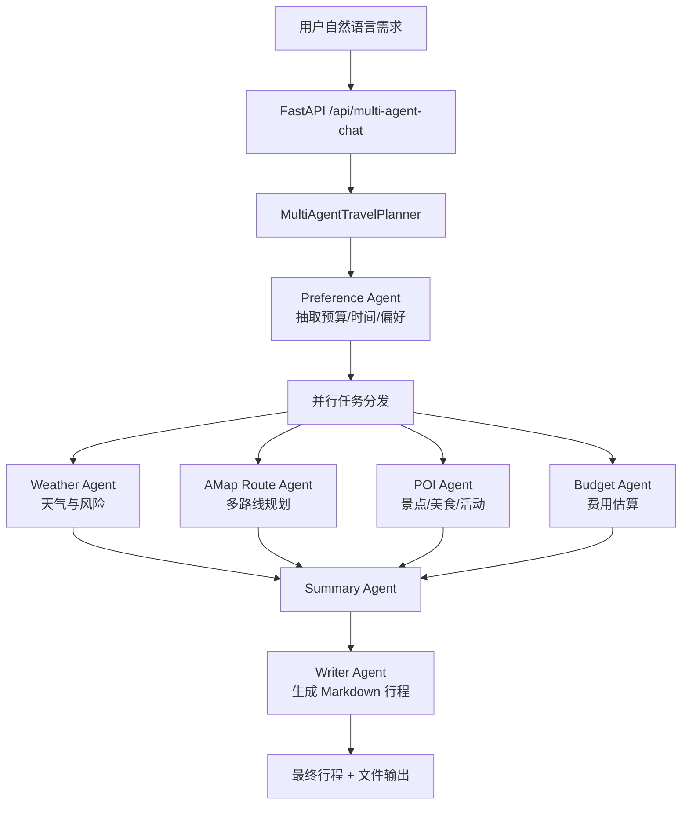

# TravelMind 多 Agent 升级笔记

参考项目：[bcefghj/multi-agent-travel-planner](https://github.com/bcefghj/multi-agent-travel-planner)

## 学到的核心设计

这个参考项目最值得学习的不是 mock 数据，也不是三语言实现，而是它的编排模型：

```text
Preference Agent
  -> Destination Agent
  -> Route/Flight Agent + Hotel Agent + Activity Agent 并行
  -> Budget Agent
  -> 超预算则调整策略并回到并行搜索
```

它把“旅行规划”拆成多个职责边界清晰的 Agent，而不是让一个 LLM 一次性完成所有事情。这样更容易解释、测试、观测，也更适合写进简历。

## 值得吸收的点

1. **共享状态对象**

   参考项目用 `TravelPlanState` 在多个 Agent 之间流转，每个 Agent 只负责读写自己的字段。这个模式比在 prompt 里塞一大段上下文更稳定。

2. **Agent 基类**

   所有 Agent 继承统一 `BaseAgent`，生命周期固定为：

   ```text
   run()
     -> execute()
     -> error handling
     -> logging
   ```

   好处是每个 Agent 的输入输出和异常处理都一致。

3. **并行执行器**

   航班、酒店、活动互不依赖，所以用 `asyncio.gather` 并行执行。这个思想可以迁移到 TravelMind：

   ```text
   Weather Agent + AMap Route Agent + POI Agent + Budget Agent
   ```

   其中天气、路线、POI 可以并行获取，最后由 Summary/Writer Agent 合并。

4. **预算反馈循环**

   Budget Agent 不是只做加法，而是能决定：

   ```text
   预算通过 -> 输出行程
   超预算 -> 降级策略 -> 重新规划
   达到最大次数 -> 输出当前最优方案
   ```

   这是面试里很好讲的“闭环 Agent”能力。

5. **面试材料意识**

   它把架构图、代码讲解、面试 QA、简历模板都放进仓库。我们项目后续也应该补：

   - 架构设计文档
   - 工具调用链路说明
   - 高德 MCP 接入说明
   - Agent 失败降级策略
   - 简历 bullet 和 STAR 描述

## 不建议照搬的点

1. **mock 数据太多**

   参考项目里的航班、酒店、活动基本是模拟数据。我们现在已经接入高德路线规划和 MCP 工具，应该保留“真实工具调用”作为亮点。

2. **三语言实现不适合当前阶段**

   Python + Java + Go 很适合展示广度，但会拖慢我们把项目做精。当前 TravelMind 应该先把 Python 版本做好。

3. **Destination Agent 对我们不是第一优先级**

   我们的用户通常会明确说“从广州到深圳”或“从福州到厦门”，所以目的地推荐不是 MVP 核心。可以后续做成“目的地推荐模式”。

## TravelMind v2 已实现架构



## 和当前项目的结合方式

当前 TravelMind 已经具备：

- LangGraph ReAct Agent
- FastMCP Server
- 高德 `amap_geocode`
- 高德 `amap_plan_routes`
- 天气工具
- 高德 POI 搜索工具
- 预算估算
- Markdown 文件生成
- Web Demo 和工具调用轨迹

我们没有换仓库，而是在现有项目上加了一层多 Agent 编排：

```text
sync/
  multi_agent/
    schemas.py              # TravelPlanState / UserPreferences
    base_agent.py           # BaseAgent
    preference_agent.py     # 抽取用户偏好
    weather_agent.py        # 调 MCP get_weather
    amap_route_agent.py     # 调 MCP amap_plan_routes
    poi_agent.py            # 调 MCP search_poi，高德 POI 优先
    budget_agent.py         # 调 MCP estimate_budget + 校验预算
    writer_agent.py         # 调 MCP write_itinerary_file
    orchestrator.py         # Pipeline + 并行执行 + trace 汇总
```

这样我们的项目会比参考仓库更强：参考仓库有漂亮的多 Agent 架构，但多是 mock；TravelMind 有真实 MCP + 高德路线/天气/POI 工具，再补多 Agent 编排，就很适合简历。

## 已完成的升级

- 新增 `sync/multi_agent/` 包，包含状态模型、Agent 基类、专业 Agent 和总控编排器。
- `PreferenceAgent` 负责解析自然语言需求，抽取出发地、目的地、天数、人数、预算、偏好和文件生成意图。
- `WeatherAgent`、`AMapRouteAgent`、`POIAgent`、`BudgetAgent` 通过线程池并行调用 MCP 工具。
- `AMapRouteAgent` 优先调用高德 `amap_plan_routes`，失败时降级到本地 `plan_route`。
- `POIAgent` 通过 `search_poi` 优先调用高德 POI 搜索，返回景点/餐厅名称、地址、评分和人均，失败时降级到本地示例库。
- `BudgetAgent` 不只返回估算，还会判断是否超出用户预算。
- `WriterAgent` 汇总事实结果，输出中文 Markdown，并按需调用 `write_itinerary_file` 写入 `outputs/`。
- FastAPI 新增 `/api/multi-agent-chat`，前端默认调用该接口。
- Web 端右侧面板从“工具调用轨迹”升级为“Agent 协作轨迹”，展示每个 Agent 的状态、耗时、输入和输出摘要。

## 简历表述升级

原来可以写：

> 基于 LangGraph + MCP 构建智慧出行 Agent，实现天气查询、高德路线规划、POI 推荐、预算估算和 Markdown 行程生成。

升级后可以写：

> 设计并实现多 Agent 智慧出行规划系统，采用 Supervisor + 专业 Agent 编排模式，将偏好抽取、天气风险、高德多路线规划、POI 推荐、预算校验和行程生成拆分为独立 Agent；通过并行执行和预算反馈循环降低响应延迟并支持超预算自动降级。

再加一条：

> 接入高德 Web 服务与 MCP 工具协议，实现驾车/公交/步行/骑行多路线对比，并在 Web 端展示 Agent 工具调用轨迹、路线推荐依据和本地 Markdown 行程文件生成结果。

## 下一步增强方向

1. 增加预算反馈循环：预算超出时自动降低酒店档位、减少付费体验或优先公共交通后重新规划。
2. 增加路线评分器：综合耗时、费用、步行距离、换乘次数和天气风险给出可解释打分。
3. 增加 POI 行程排序：按用户偏好、距离、评分、人均和天气风险自动生成每日游玩顺序。
4. 增加测试集：固定典型城市对和异常输入，验证解析、降级和文件生成。
5. 增加面试材料：补充架构图、核心代码讲解、STAR 项目描述和常见追问回答。
