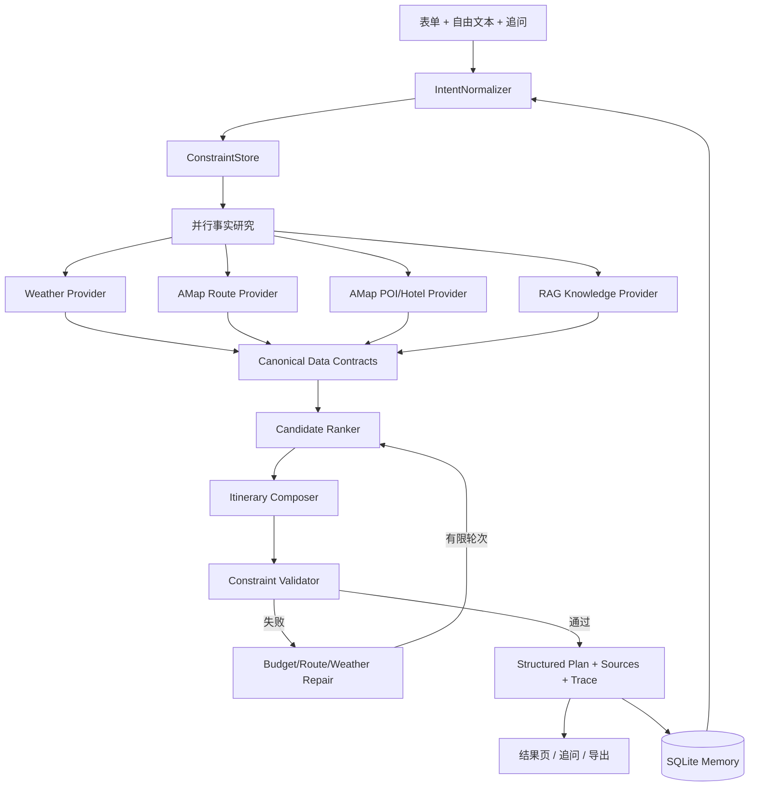

# TravelMind GitHub 同类项目对比与优化方案

更新时间：2026-07-31

本报告基于 GitHub Repository Search、公开仓库 README、目录树和部分核心源码的公开内容整理。Star 数为检索时快照，项目状态和依赖会随时间变化；正式引入前仍需单独核对许可证、接口可用性和供应商条款。

## 1. 结论先行

TravelMind 当前的基础选型没有明显方向性错误：Python + FastAPI + LangGraph/LangChain + FastMCP + 高德 + DeepSeek 已经覆盖了事实获取、规划、工具协议和 Web 展示。

“生成结果不够智能”的主要矛盾集中在规划闭环，而不是单纯模型能力：

- 用户自由文本约束没有进入结构化 `/api/plan` 请求。
- 候选地点有事实字段，但缺少统一的候选评分和全局选择策略。
- 预算超支只产生建议，没有触发真正的替换、降级和重新规划。
- 路线评审偏逐段，缺少整天的时间窗、营业时间、天气和疲劳度联合约束。
- 追问仍调用旧文本多 Agent 链路，尚未直接修订当前结构化计划。
- 长期记忆、目的地知识库和质量评测集尚未形成。
- 规划进度主要是前端模拟，长请求缺少可恢复任务状态和真实事件流。

推荐路线：保留现有技术栈，吸收以下机制：

1. `bcefghj/multi-agent-travel-planner` 的预算反馈循环。
2. `datarootsio/langgraph-template-travel-planner` 的 typed state、条件边、HITL、checkpoint 和 Langfuse 观测。
3. `kbhujbal/Multi-Agent-AI-Travel-Advisor` 的“纯 API 数据层 / AI 分析层”分离和 RAG。
4. `Y-66/Traveler` 的 MCP、Skills、Memory、Knowledge Base、Team/Workflow 分层。
5. `LeeFly-cn/TripStar-Java` 的高德事实校准、结构化 DTO、独立 Review、WebSocket 进度和 Trace。
6. `BjornMelin/tripsage-ai` 的 schema-first 输出、混合 RAG、持久化、缓存、后台任务和 E2E 质量门禁。

## 2. 项目横向比较

| 项目 | 主要功能 | 核心架构 | 技术栈 | 优点 | 局限/风险 | 对 TravelMind 的价值 |
|---|---|---|---|---|---|---|
| [bcefghj/multi-agent-travel-planner](https://github.com/bcefghj/multi-agent-travel-planner) | 目的地、航班、酒店、活动、预算、每日行程 | Preference -> Destination -> 三路并行搜索 -> Budget；超预算最多 3 轮调整 | Python/FastAPI/asyncio；另有 Java Spring Boot、Go Gin；Pydantic；Streamlit | 编排容易解释；并行清晰；预算循环直接改善结果；有测试和架构文档 | 默认 Mock 数据；真实地点和实时供应商闭环较弱；三语言维护成本高 | 直接借鉴预算反馈循环、状态字段和阶段化 Agent |
| [datarootsio/langgraph-template-travel-planner](https://github.com/datarootsio/langgraph-template-travel-planner) | 旅行参数提取、缺参补全、路由、对话、MCP、人工介入 | LangGraph StateGraph + router + conditional edges + `interrupt_before` + checkpoint | Python 3.13；LangGraph；MCP adapters；OpenAI；Reflex；Langfuse；Pydantic | 工程骨架清晰；缺参时进入 HITL；追踪和评估入口完整；容易迁移到其他 Agent 产品 | 更像模板而非旅行事实产品；默认 MemorySaver 仍需持久化改造；依赖版本较新 | 借鉴图式编排、人工补充关键条件、可恢复状态和观测体系 |
| [kbhujbal/Multi-Agent-AI-Travel-Advisor](https://github.com/kbhujbal/Multi-Agent-AI-Travel-Advisor) | 航班、住宿、活动、物流、文化/签证知识、行程合成 | 4 个纯 HTTP 服务并行 -> RAG Knowledge Expert -> Itinerary Compiler；AI 不直接抓事实 | Python；FastAPI；httpx/asyncio；CrewAI；LangChain；ChromaDB；React/Vite | “事实服务与 AI 分析”边界清楚；真实 API 优先；RAG 只提供知识补充；架构易测试 | API Key 数量多；供应商稳定性和费用高；CrewAI 与现有 LangGraph 不能直接复用 | 借鉴数据层隔离、统一服务接口、RAG 位置和并行搜索 |
| [Y-66/Traveler](https://github.com/Y-66/Traveler) | 多轮对话、团队协作、工作流、MCP、Memory、Skills、RAG、航班/酒店/景点工具 | Agno Agent/Team/Workflow；Research -> Budget -> Plan；技能和知识库插件化 | Python 3.12；Agno；FastAPI；ChromaDB/LanceDB；SQLite/SQLAlchemy；Typer；Loguru | 对“智能感”的组成拆得完整；长期偏好、知识库和技能可复用；支持离线/无 MCP 模式 | Agno 生态迁移成本；功能面容易变大；知识库质量和 Memory 污染需要治理 | 借鉴 Memory、目的地知识、Skills 和 workflow 分层，不直接更换框架 |
| [LeeFly-cn/TripStar-Java](https://github.com/LeeFly-cn/TripStar-Java) | 自主规划、指定小红书笔记规划、多模态图片理解、高德 POI/天气/酒店/餐饮、地图、预算、知识图谱 | StateGraph + ReactAgent；Research -> POI/天气/酒店 -> Planner -> Review；WebSocket 任务流 | Java 21；Spring Boot 4；Spring AI Alibaba；React；MySQL；Redis；Node.js 小红书运行时 | 真实事实校准强；每阶段 DTO 清晰；Review 独立；Trace 和实时进度完整；产品闭环成熟 | 依赖重；小红书签名/Cookie/风控和多服务运维复杂；GPL-2.0 需谨慎评估 | 借鉴结构化 DTO、任务状态、Review、Trace、实时进度和“指定攻略导入”思路 |
| [BjornMelin/tripsage-ai](https://github.com/BjornMelin/tripsage-ai) | 多工具搜索、航班、住宿、路线、预算、记忆、协作、文件和工具审批 | Next.js server-first；AI SDK ToolLoop/structured output；RAG + memory；QStash 后台任务 | Next.js 16；React 19；TypeScript 6；Vercel AI SDK v7；Supabase/pgvector/RLS；Upstash Redis/QStash；OpenTelemetry；Playwright | schema-first；持久化、缓存、限流、幂等、观测、E2E 和安全边界完整；更接近产品工程 | 基础设施复杂；强绑定 Vercel/Supabase/Upstash；部署成本和学习成本高 | 借鉴结构化输出、持久化、缓存、任务幂等、工具审批和质量门禁 |
| [nishant-sharma-99/PlanetPath-AI-Travel-Planner](https://github.com/nishant-sharma-99/PlanetPath-AI-Travel-Planner) | 航班、酒店、日程、路线地图、PDF、会话恢复 | LangGraph Supervisor -> Flight/Hotel/Itinerary/Final；PostgreSQL checkpointer | FastAPI；LangGraph；Groq；AviationStack；Tavily；Nominatim；PostgreSQL | 和 TravelMind 同为 Python/FastAPI/LangGraph；真实航班/搜索数据；Postgres 会话状态；端到端形态简洁 | 规划约束较少；酒店主要依赖 Web 搜索；Supervisor 和最终文本之间的结构化校验较薄 | 借鉴 thread/checkpoint、任务接口和持久化会话，避免仅依赖浏览器 localStorage |

### 补充的产品 UI 参考

[hardikverma22/travel-planner-ai](https://github.com/hardikverma22/travel-planner-ai) 使用 Next.js 14、Convex、Clerk、OpenAI、Tailwind/shadcn，强调四步规划、可行性检查、费用追踪、邀请协作和响应式 SaaS 体验。它适合作为产品流程参考，但当前公开说明对多 Agent、事实来源和约束验证的细节少于上述项目。

## 3. 各项目最值得借鉴的机制

### 3.1 预算反馈循环

`bcefghj` 把预算当作规划过程中的反馈信号，而不是最终报表：并行搜索后检查预算，超支时按策略调整，再回到搜索阶段，最多执行有限轮次。

TravelMind 当前在最终行程形成后计算预算，超支只返回建议。应改为：

```text
初版行程
  -> 预算评估
  -> 预算内：继续质量评审
  -> 超预算：按用户策略调整酒店/活动/交通
  -> 只重算受影响部分
  -> 最多 2-3 轮
  -> 输出调整前后差异和最终方案
```

### 3.2 事实层与 AI 层分离

`kbhujbal` 的关键设计是：航班、酒店、活动、路线服务只负责获取和规范化数据，AI 负责解释、排序和组合。这样模型无法用一句自然语言覆盖掉事实层的缺失。

TravelMind 已有高德和 MCP，但 MCP 主要返回文本，规划器再用正则解析。下一步应把工具输出升级为 JSON contract，保留文本兼容层：

```text
PlaceCandidate
  id / name / category / city / address / point
  rating / cost / price_range / source / observed_at / confidence
  cluster / indoor_outdoor / reservation_hint / opening_hours
```

### 3.3 结构化状态与质量门

`dataroots`、`TripStar` 和 `TripSage` 的共同点是：每阶段都有明确状态/DTO，模型输出要经过 schema 校验，最终计划还有独立的 Review 或验证节点。

TravelMind 已有 `preferences`、`pois`、`itinerary_days`、`quality_review`，但它们目前集中在一个超大规划模块中，且质量分数主要是报告结果。应把 Review 升级为真正的质量门：硬性约束失败时触发替换/回滚，软性约束只影响排序和解释。

### 3.4 Memory、RAG 与 Skills

`Y-66/Traveler` 把用户偏好、目的地指南、预算技能、意图分析和计划验证拆成可插拔能力；`TripSage` 进一步加入 pgvector、混合检索、缓存和后台同步。

TravelMind 适合先做轻量版本：

- SQLite 保存用户明确偏好和每次计划的约束，不立即引入分布式数据库。
- ChromaDB 或 LanceDB 保存经过审核的目的地指南、预约规则、雨天替代建议和交通常识。
- RAG 只补充背景知识和解释，不生成高德 POI、实时价格或库存。
- 将预算优化、雨天替换、片区规划、返程检查写成可测试的 skill/rule 模块。

### 3.5 真实任务进度与可观测性

`TripStar` 使用 WebSocket 推送阶段和错误，`TripSage` 使用 SSE/QStash/OTel，`dataroots` 使用 Langfuse 和可中断图。TravelMind 当前进度条按定时器推进，和真实 Agent 完成状态无关。

应让后端产生真实事件：`task_created`、`research_started`、`tool_finished`、`candidate_ranked`、`plan_drafted`、`validation_failed`、`repair_finished`、`task_completed`，前端只消费事件。

## 4. TravelMind 当前差距矩阵

| 能力 | 当前状态 | 结果影响 | 优先级 |
|---|---|---|---|
| 自由文本约束 | 页面只有固定字段，结构化请求缺少 `free_text` | “带老人、少走路、一定去某处、不要某处”等信息容易丢失 | P0 |
| 候选数据 | 高德优先，但工具多返回文本，规划器用正则解析 | 候选字段不稳定，难以做可靠排序 | P0 |
| 候选排序 | 有去重、片区和局部规则，缺少统一评分 | 选择看起来像模板，个性化弱 | P0 |
| 预算优化 | 末端计算，超支只给建议 | 结果没有闭环调整 | P0 |
| 路线规划 | 相邻段评审，缺少全局时段/营业/疲劳优化 | 每段看似合理，整天仍可能不顺 | P1 |
| 天气适配 | 有天气建议文本，活动替换能力弱 | 雨天/高温下行程仍可能偏户外 | P1 |
| 追问闭环 | 走旧 `/api/multi-agent-chat`，不回写计划 | 用户调整后结果页不一致 | P0 |
| Memory | 仅浏览器端少量 hint | 多次使用后仍需重复说明 | P1 |
| RAG | 当前没有目的地知识库 | 预约、季节、文化和本地规则解释有限 | P1 |
| 任务状态 | 同步长请求，前端模拟进度 | 延迟高时缺少可恢复性和真实反馈 | P1 |
| 质量评测 | 22 个回归测试，缺少效果指标 | 很难判断“更智能”是否真的改善 | P0 |

## 5. 推荐目标架构

保持 Python/FastAPI/LangGraph/FastMCP，不做框架迁移。将当前大型 `StructuredTravelPlanner` 逐步拆成明确节点，但先保持 `/api/plan` 响应兼容。



### 建议的核心数据模型

新增一组独立的 Pydantic contract，避免继续让规划器直接消费长文本：

- `TripRequest`：城市、日期、人数、预算、兴趣、自由文本、必须满足、避开项、饮食、行动能力、节奏和交通容忍。
- `TravelConstraint`：`hard`/`soft`、来源、优先级、可验证条件和冲突信息。
- `PlaceCandidate`：地点事实、坐标、类别、评分、费用、来源、观测时间、置信度、片区、室内/室外和预约提示。
- `RouteOption`：模式、起终点、距离、时长、费用、换乘、来源和适用条件。
- `DayPlan`：时间槽、地点、移动段、预计成本、天气适配和约束命中。
- `ValidationIssue`：级别、规则、受影响 item、证据、修复动作。
- `PlanTraceEvent`：阶段、调用、输入摘要、来源、耗时、状态、重试和决策理由。

## 6. 分阶段实现方案

### Phase 0：建立“智能程度”评测基线

目标：先让效果可以被比较。

工作内容：

- 建立 8-12 个固定场景：周末短途、跨城高铁、长距离飞机、雨天、轻松节奏、低预算、亲子/老人、指定必去/避开地点、POI 稀疏和 MCP 失败。
- 为每个场景准备 MCP fixture，避免评测依赖高德 QPS 和模型随机性。
- 记录指标：真实地点绑定率、重复地点率、硬约束满足率、路线超容忍率、预算偏差、雨天适配率、返程住宿串台率、LLM fallback 率、P50/P95 延迟和调用次数。
- 在现有 22 个回归测试之外增加 `tests/evals/`，先用规则断言，再接 LLM-as-judge 作为辅助指标。

验收：同一个输入可以稳定复现，后续每次优化都有前后对比数据。

### Phase 1：统一输入、追问和计划状态

目标：让用户表达的真实需求进入同一条结构化规划链路。

工作内容：

- `PlanRequest` 增加 `freeText`、`mustVisit`、`avoid`、`dietaryNeeds`、`accessibilityNeeds`、`specialRequirements`。
- 提取 `IntentNormalizer`，将表单和自然语言都转换为 `TravelConstraint`。
- 增加 `POST /api/plan/{plan_id}/refine`：输入追问和当前计划版本，返回新的结构化计划、变更摘要和验证结果。
- 追问不再只生成文本回答，而是判断意图：解释、修改、替换、重新规划；修改类请求进入局部修复图。
- 初期用 SQLite/本地 JSON 保存 `plan_id`、版本、原始约束和 trace，暂不引入分布式基础设施。

验收：用户说“第二天少走路、不要公交、保留某景点、预算降到某值”后，结果页的每日行程、路线和预算同步变化；旧的 `/api/multi-agent-chat` 继续保留兼容。

### Phase 2：结构化事实与候选排序

目标：让模型从“更好的候选集合”中做选择，而不是直接面对文本。

工作内容：

- 为 `search_poi`、`search_hotels`、`amap_plan_routes` 增加 JSON 输出 contract：事实、来源、时间、置信度和错误原因分开。
- 在 `sync` 下新增 provider/contract 层；保留旧文本解析作为兼容 fallback。
- 建立候选硬过滤：城市、类别、坐标、去重、地点来源、返程规则、已满足的必须项。
- 建立可解释软评分：偏好命中、评分、费用、片区一致性、与上一站距离、天气适配、住宿策略和用户节奏。
- 每个候选输出 `score_breakdown`，前端展示“为何入选”和“数据来源”。

建议评分形式：

```text
总分 = 偏好匹配 30%
     + 片区/距离 25%
     + 天气适配 15%
     + 预算适配 15%
     + 评分/质量 10%
     + 多样性 5%
```

权重做成配置，并通过 Phase 0 场景调参；硬性约束不参与加权，而是直接过滤或触发修复。

验收：同一城市不同偏好产生可解释的候选差异；真实地点绑定率稳定；泛化建议与可上地图 POI 始终分层。

### Phase 3：把行程生成升级为有限状态图

目标：形成“研究 -> 组合 -> 校验 -> 修复 -> 输出”的真正闭环。

建议节点：

1. `normalize_request`
2. `parallel_research`
3. `canonicalize_facts`
4. `rank_candidates`
5. `compose_draft`
6. `validate_hard_constraints`
7. `validate_route_and_time`
8. `optimize_budget`
9. `adapt_weather`
10. `review_and_repair`
11. `finalize_plan`

关键规则：

- `hard` 约束失败时进入修复或回滚，最终响应保留失败证据。
- 预算超支优先按用户选择降级：住宿档位、付费活动、跨城模式、打车比例。
- 每轮只重算受影响的搜索/排序/行程节点，最多 2-3 轮，记录 diff。
- 路线优化先用确定性启发式：按片区聚类、时间槽、移动矩阵和天气排序；后续数据量足够时再评估 OR-Tools。
- DeepSeek 负责偏好解释、候选组合和理由表达；规则/地图事实负责可执行性和最终裁决。

验收：超预算输入会自动形成替代方案；长距离公共交通或雨天户外活动会被替换或明确标红；每天行程能给出主片区、移动总时长和约束命中。

### Phase 4：知识库、Memory 与真实任务事件

目标：提升连续使用时的个性化和长请求体验。

工作内容：

- SQLite 保存用户明确偏好、计划版本、约束变化和用户反馈；隐式偏好只在用户确认后沉淀。
- 增加目的地知识文档：预约规则、季节性、室内替代、交通常识、区域攻略和本地礼仪。
- 先用 ChromaDB/LanceDB 做本地 RAG；文档带城市、主题、更新时间和可信来源元数据。
- RAG 仅提供背景知识和解释，POI/路线/价格仍以 provider 事实为准。
- 规划请求改为后台 task：`task_id` + 真实阶段事件；页面用 SSE 或 WebSocket 更新，而不是计时器模拟。
- trace 持久化到 JSON/Markdown；有 Langfuse 时接入可选上报，没有 Key 时本地仍可运行。

验收：刷新页面后可恢复任务/计划；页面显示真实阶段状态；第二次规划能引用用户已确认的偏好；关键数据能回溯来源和时间。

### Phase 5：前端呈现与质量闭环

目标：让用户感知到“智能”来自可解释的选择和可控的调整。

工作内容：

- 结果页增加约束摘要、候选选择理由、来源时间、路线总耗时、预算调整 diff 和质量评分。
- 追问后展示“修改了什么、保留了什么、哪些约束仍未满足”。
- 提供“严格满足 / 更省钱 / 更轻松”三种优化动作，映射到同一计划修复 API。
- 显示候选替代项，让用户能快速选择而非重新输入整段需求。
- 真实事件驱动进度，保留失败阶段、重试次数和降级原因。
- Playwright 覆盖桌面、移动端、规划、追问、编辑、恢复和导出；效果评测和浏览器 E2E 都纳入 CI 门禁。

## 7. 推荐的首个 MVP 范围

一次性做完所有外部项目的能力会扩大风险。建议第一轮只做以下四项：

1. `freeText`/硬性约束进入 `/api/plan`。
2. 追问改为结构化计划 refine，并保留版本 diff。
3. 候选 JSON contract + 可解释排序。
4. 预算超支的有限反馈循环。

这四项直接命中“结果不够智能”的用户感知，同时仍能沿用现有高德、DeepSeek、FastAPI 和前端结构。RAG、Memory、WebSocket、UI 深化作为第二轮，框架迁移不列入计划。

## 8. 关键取舍

### 保留 LangGraph，而不是迁移 CrewAI/Agno

当前项目已经有结构化规划、规则降级和回归测试；迁移框架会带来状态、工具适配、测试和前端契约的全量重写。CrewAI/Agno 的 Team/Workflow/Skills 思路可以吸收，框架本身暂时保留。

### RAG 不替代高德事实

RAG 用于目的地背景、预约、文化和雨天策略；POI 坐标、路线、价格和实时状态继续由 MCP/provider 提供。这样可以同时获得更丰富的解释和更稳定的事实边界。

### 先本地持久化，再引入 Redis/Postgres

当前是本地演示项目，SQLite 足以支持计划版本、Memory 和任务状态。只有在多用户部署、后台任务和跨进程并发成为目标后，再引入 Redis/QStash/Postgres。

### 先规则优化，再上复杂求解器

先用片区聚类、候选评分、时间槽和移动矩阵解决主要问题；当有稳定评测集和更丰富的营业时间/预约数据后，再评估 OR-Tools 或更复杂的全局搜索。

## 9. 参考项目索引

- [bcefghj/multi-agent-travel-planner](https://github.com/bcefghj/multi-agent-travel-planner)
- [datarootsio/langgraph-template-travel-planner](https://github.com/datarootsio/langgraph-template-travel-planner)
- [kbhujbal/Multi-Agent-AI-Travel-Advisor](https://github.com/kbhujbal/Multi-Agent-AI-Travel-Advisor)
- [Y-66/Traveler](https://github.com/Y-66/Traveler)
- [LeeFly-cn/TripStar-Java](https://github.com/LeeFly-cn/TripStar-Java)
- [BjornMelin/tripsage-ai](https://github.com/BjornMelin/tripsage-ai)
- [nishant-sharma-99/PlanetPath-AI-Travel-Planner](https://github.com/nishant-sharma-99/PlanetPath-AI-Travel-Planner)
- [hardikverma22/travel-planner-ai](https://github.com/hardikverma22/travel-planner-ai)
