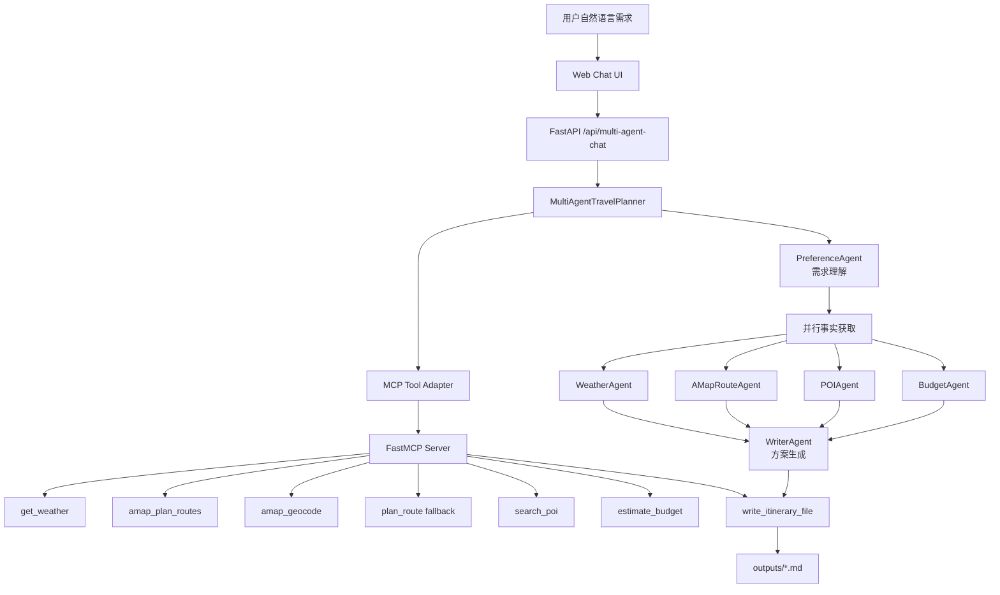

# TravelMind: Multi-Agent + MCP 智慧出行 Agent

> 整理自根目录 `TRAVELMIND_README.md`，2026-08-04 合并；修复了对已删除文件 `MULTI_AGENT_UPGRADE.md` 的引用，并更新了项目路径。产品对外介绍以此文档为准。

TravelMind 是一个基于多 Agent 编排和 MCP 工具协议的智慧出行助手。用户可以用自然语言提出出行需求，系统会拆分为需求理解、天气风险、高德路线、景点美食、预算评估和行程写作等专业 Agent，并调用真实工具生成结构化旅行方案。

## 项目亮点

- 多 Agent 编排：将出行规划拆成多个职责明确的 Agent，支持并行获取天气、路线、POI 和预算事实。
- MCP 工具接入：通过 MCP Server 暴露天气、高德路线规划、POI、预算、文件写入等工具。
- 高德真实路线：接入高德地理编码与路线规划，支持驾车、公交/地铁、步行、骑行多路线对比。
- 高德真实 POI：调用高德地点搜索获取景点、餐厅、评分、人均和地址，失败时降级到本地示例库。
- Web 演示界面：包含聊天窗口、工具列表、系统架构图和 Agent 协作轨迹。
- 文件生成：Agent 可将完整行程保存为 Markdown 文件，输出到 `outputs/`。
- 简历友好：能讲清楚 Agent 编排、MCP 协议、外部 API 接入、失败降级和可视化观测。

> 架构思路吸收 `bcefghj/multi-agent-travel-planner` 的 Pipeline + 并行执行思想，并结合本项目的高德 MCP 工具做真实增强；详见 [open-source-comparison.md](open-source-comparison.md)。

## 系统架构



项目仍保留 `/api/chat` 的 LangGraph ReAct 单 Agent 入口，方便对比"单 Agent 工具调用"和"多 Agent 专业分工"的效果。

## MCP 工具

| 工具 | 作用 |
| ---- | ---- |
| `get_weather` | 查询指定城市和日期的天气 |
| `amap_geocode` | 调用高德地理编码，将地址转换为经纬度坐标 |
| `amap_plan_routes` | 调用高德路线规划，并补充高铁/城际铁路建议，返回高铁、驾车、公交、步行、骑行等多路线方案 |
| `plan_route` | 本地路线规划降级工具，在高德 Key 未配置或调用失败时兜底 |
| `search_poi` | 优先调用高德 POI 搜索，推荐目的地景点、美食、评分、人均和地址，失败时降级本地示例库 |
| `estimate_budget` | 估算交通、住宿、餐饮、门票和市内交通成本 |
| `write_itinerary_file` | 将完整行程写入本地 Markdown 文件 |
| `get_current_time` | 获取当前时间 |

## 启动方式

准备环境（代码根目录为 `my-langgraph-agent-main/`）：

```powershell
cd D:\Codexwork\Gold-WC\my-langgraph-agent-main
python -m venv .venv
.\.venv\Scripts\python.exe -m pip install --upgrade pip
.\.venv\Scripts\python.exe -m pip install -r requirements.txt fastmcp
```

配置 `.env`：

```env
DEEPSEEK_API_KEY=你的 DeepSeek API Key
AMAP_MAPS_API_KEY=你的高德 Web服务 Key
# 高德 API 稳定性保护，可按需调整。
AMAP_CACHE_TTL_SECONDS=600
AMAP_CACHE_MAX_ITEMS=256
AMAP_MIN_REQUEST_INTERVAL_SECONDS=0.45
AMAP_MAX_RETRIES=3
# 可选：直接加载高德官方远程 MCP 工具，默认建议先关闭。
ENABLE_AMAP_REMOTE_MCP=false
```

高德 Key 需要在高德开放平台创建 Web服务 Key。项目同时兼容 `AMAP_API_KEY` 和 `GAODE_API_KEY` 变量名。
如果需要直接连接高德官方 MCP，可设置 `ENABLE_AMAP_REMOTE_MCP=true`；项目会自动使用 `https://mcp.amap.com/mcp?key=...`。也可以手动设置 `AMAP_MCP_URL`。

如果遇到 `CUQPS_HAS_EXCEEDED_THE_LIMIT`，表示高德接口短时间请求过密。项目已在统一高德请求入口增加缓存、串行限速和退避重试：

- `AMAP_CACHE_TTL_SECONDS`：相同请求的缓存时间，默认 600 秒。
- `AMAP_CACHE_MAX_ITEMS`：最多缓存多少条高德响应。
- `AMAP_MIN_REQUEST_INTERVAL_SECONDS`：两次高德请求之间的最小间隔，默认 0.45 秒。
- `AMAP_MAX_RETRIES`：遇到 QPS 限流或临时网络错误时的最大重试次数，默认 3。

终端 1 启动 MCP Server：

```powershell
cd D:\Codexwork\Gold-WC\my-langgraph-agent-main
$env:MCP_PORT="8098"
.\.venv\Scripts\python.exe sync\fastmcp_server_streamhttp.py
```

终端 2 启动 Web Demo：

```powershell
cd D:\Codexwork\Gold-WC\my-langgraph-agent-main
$env:MCP_SERVER_URL="http://127.0.0.1:8098/my-custom-path"
.\.venv\Scripts\python.exe -m uvicorn sync.travel_web_app:app --host 127.0.0.1 --port 8010
```

浏览器打开：

```text
http://127.0.0.1:8010
```

## 演示 Prompt

```text
我明天从福州南站去厦门北站，再到鼓浪屿玩两天。请用高德路线规划给我多个出行路线，对比驾车和公共交通，给出推荐方案、天气、景点和预算，并生成行程文件。
```

预期结果：

- 调用 `get_today` 确认日期。
- `PreferenceAgent` 抽取出发地、目的地、日期、天数、预算和是否生成文件。
- `WeatherAgent` 调用 `get_weather` 查询福州和厦门天气。
- `AMapRouteAgent` 调用 `amap_plan_routes` 获取高德坐标、多路线方案和高铁/城际铁路建议。
- 对比驾车、公共交通、步行/骑行接驳等路线，输出推荐方案和原因。
- `POIAgent` 调用 `search_poi`，通过高德 POI 搜索推荐厦门景点、美食、评分、人均和地址。
- `BudgetAgent` 调用 `estimate_budget` 估算预算并判断是否超预算。
- `WriterAgent` 调用 `write_itinerary_file` 生成 Markdown 行程文件。

## 简历写法

> 设计并实现 Multi-Agent 智慧出行规划系统，将偏好抽取、天气风险、高德多路线规划、POI 推荐、预算校验和行程生成拆分为独立 Agent；通过并行执行降低响应延迟，并在 Web 端展示 Agent 协作轨迹。

> 接入高德地理编码、天气、路线规划与 POI 搜索能力，支持高铁/城际、驾车、公交/地铁、步行/骑行接驳路线对比，并结合真实景点餐厅、评分、人均、地址和预算结果生成可落地的出行建议。

> 基于 FastMCP 封装天气、路线、POI、预算和文件写入工具，通过 MCP Tool Adapter 接入应用层，实现工具协议解耦、路线失败降级和 Markdown 行程文件生成。
