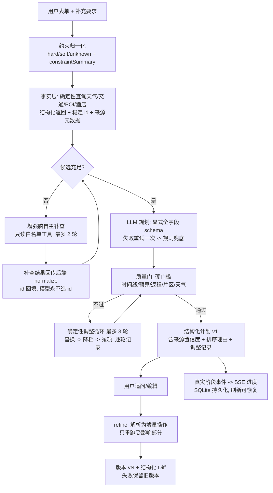
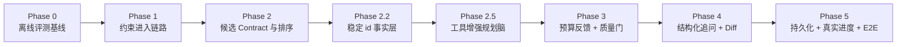

# TravelMind 目标架构与理想规划流程

> 本文回答一个问题：**一次旅行规划，现状是怎么跑的，理想终态应该怎么跑，中间差在哪里、由哪个 Phase 补齐。**
> 阶段执行细节见 [implementation-plan.md](implementation-plan.md)；勘察与验证证据见 [findings.md](findings.md)；给非技术读者的白话版见 [how-it-works.md](how-it-works.md)。

## 1. 三条贯穿始终的心法

1. **高德提供事实**：路线、天气、POI、酒店都来自真实查询，可追溯来源与可信度。
2. **DeepSeek 负责决策**：排行程、评路线、检质量、补常识价格；允许"自主补查"，不允许"编造"。
3. **规则负责兜底**：LLM 失败走规则行程；高德失败走本地知识库；任何降级都可见、可解释。

这三条不是临时取舍，而是经过验证的设计定位（见 findings.md 与 open-source-comparison.md），后续所有 Phase 都不得破坏。

## 2. 现状流程与五处断点

```mermaid
flowchart TD
    A[用户表单 + 补充要求] --> B[PlanRequest 归一化<br/>preferences + constraintSummary]
    B --> C1[天气/交通/POI/酒店<br/>toolbox -> MCP -> 高德, 返回文本]
    C1 --> D[正则解析文本<br/>normalize_place_candidates<br/>rank_candidates]
    D --> E[DeepSeek 规划脑 plan<br/>吃带 id 候选 -> 行程 JSON]
    E --> F[评审/返工 review_itinerary<br/>+ 规则质量检查]
    F --> G[市内路线段 + 地图 + 预算<br/>全部规则计算]
    G --> H[结构化计划 JSON + trace<br/>前端渲染 + 前端假进度]
    H -.追问.-> I[/api/multi-agent-chat 旧文本链路<br/>与计划脱节]
    H -.编辑.-> J[前端本地改序/删除<br/>只在前端重算, 不回后端]
```

| 编号 | 断点 | 直接表现 | 由谁修复 |
|---|---|---|---|
| 1 | 事实是文本、无稳定 id | 靠正则拆字段；2026-08-14 实验证实模型会**编造 candidate_id** | Phase 2.2 稳定 id 事实层 |
| 2 | 模型只决策、不能补查 | "天气突变想换室内"无法动态满足，只能重新提交表单 | Phase 2.5 工具增强规划脑 |
| 3 | 预算只提示、不调整 | 超支输出文字建议，方案原样返回（预算偏差 0.6230） | Phase 3 预算反馈循环 |
| 4 | 追问走旧文本链路 | 追问返回新 Markdown，与当前结构化计划脱节；可能覆盖手动编辑 | Phase 4 结构化 refine |
| 5 | 无持久化、假进度 | 计划只在 localStorage；进度条是 900ms 定时器动画 | Phase 5 |

## 3. 理想终态流程



## 4. 逐环节说明与 Phase 交付映射

| 环节 | 理想行为 | 交付 Phase | 现状 |
|---|---|---|---|
| 输入 | 硬约束/软偏好/自由文本全部进入结构化偏好，全程可追踪 | Phase 1 | 已实现 |
| 事实层 | 每个地点带稳定 id、坐标、来源状态（live/降级）、置信度；模型只引用不生成 | Phase 2.2 | 文本 + 正则解析 |
| 候选层 | 硬过滤 + 可解释排序，入选/落选理由随计划输出，前端可展示 | Phase 2 + 前端展示 | 后端已实现，展示未做 |
| 规划 | 候选不足时 DeepSeek 自主补查（只读工具、上限 2 轮、结果回传归一化） | Phase 2.5 | 不能补查 |
| 质量门 | 全天时间线、移动耗时、用餐/休息间隔、返程安全余量、天气适配——硬门槛不过不发方案 | Phase 3 | 局部评审，无全局门槛 |
| 预算 | 超支时确定性替换/降档（同片区高价活动 -> 酒店档位 -> 交通），最多 2-3 轮；输出"改了什么、为什么、代价" | Phase 3 | 只提示不调整 |
| 追问 | "第二天改室内" = 只动第二天的增量操作；返回新版本 + Diff；失败不覆盖旧计划 | Phase 4 | 旧文本链路 |
| 编辑 | 前端改序/删除回传后端重新过质量门，而不是只在浏览器重算 | Phase 4 | 仅前端本地重算 |
| 进度 | 进度来自后端真实阶段事件（SSE），刷新可恢复 | Phase 5 | 定时器假进度 |
| 记忆 | 偏好、计划版本、任务状态落 SQLite；换设备可续 | Phase 5 | 仅 localStorage |
| 质量护栏 | 评测指标设发布阈值，回退自动拦发布；E2E 覆盖桌面/移动端 | Phase 5 | 无阈值、无 E2E |

## 5. 用户视角的"理想一天"

1. 填表 + 写一句"晚上十点前回酒店、预算 800" -> 点规划。
2. 进度条显示真实阶段（查天气 -> 查路线 -> 生成 -> 体检），断网刷新后能恢复。
3. 结果里每个地点标注来源与置信度（高德实时 / 规则估算）；酒店若超预算，显示"超预算 620 元/晚"并**已自动换成同片区 298 元的选项**，旁边解释原因。
4. 追问"第二天室内一点、预算不变" -> 只重排第二天 -> 显示 v2 与 v1 的 Diff（换了哪 2 个点、预算变化）。
5. 导出 Markdown / 打印 PDF；下次回来还能看到上次的计划和偏好。

## 6. 与阶段计划的关系



- Phase 0/1/2 已基本完成（Phase 2 剩余混合来源测试与低成本增强）。
- Phase 2.2 是 Phase 2.5 的硬前提：没有稳定 id，agentic 补查必然导致 id 编造（已实验证实）。
- Phase 3 以确定性规则调整为主，Phase 2.5 的增强脑只能作为"替换候选的提议者"，所有替换必须过质量门。
- Phase 4 的 refine 可复用 Phase 2.5 增强脑做受影响部分的重规划，但不依赖它。

## 7. 关键设计红线（跨 Phase 不变量）

1. 模型永不生成地点 id；只能引用后端给出的 id。
2. 新增响应字段必须可选，旧字段与旧入口（`/api/chat`、`/api/multi-agent-chat`）保持兼容。
3. 离线评测不依赖网络、Key 或当前日期；任何新路径都要有确定性 fixture。
4. 任何硬约束违规的方案不得通过质量门；反馈循环有硬上限。
5. 新路径一律 feature flag 灰度，可一键回退到现状路径。
